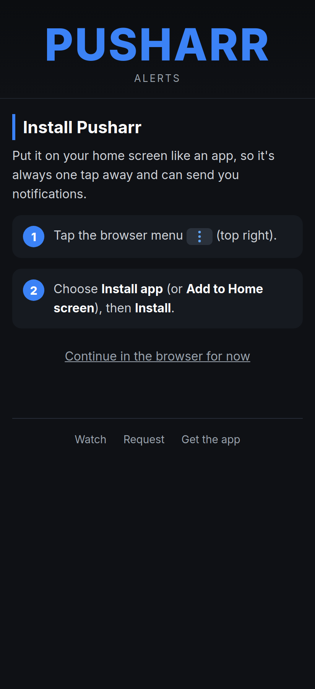
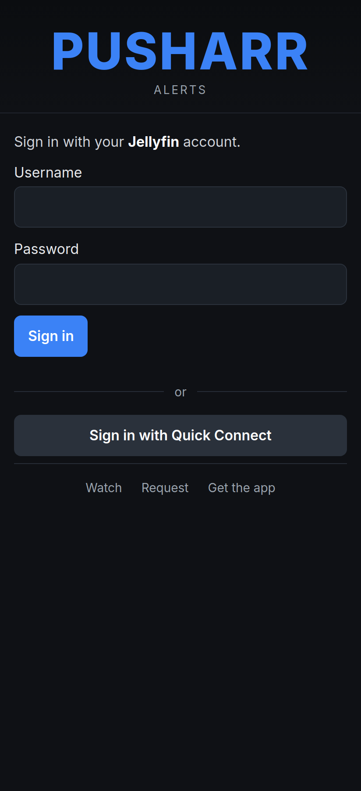
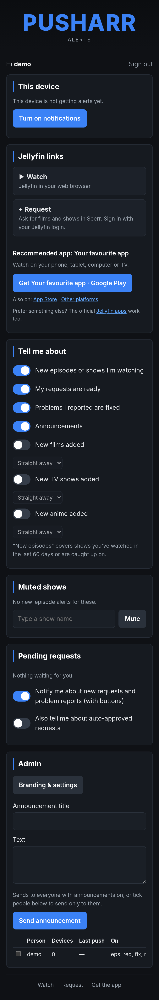
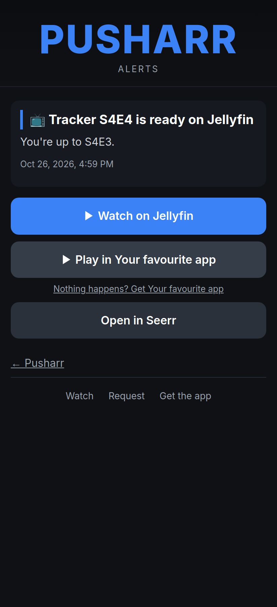
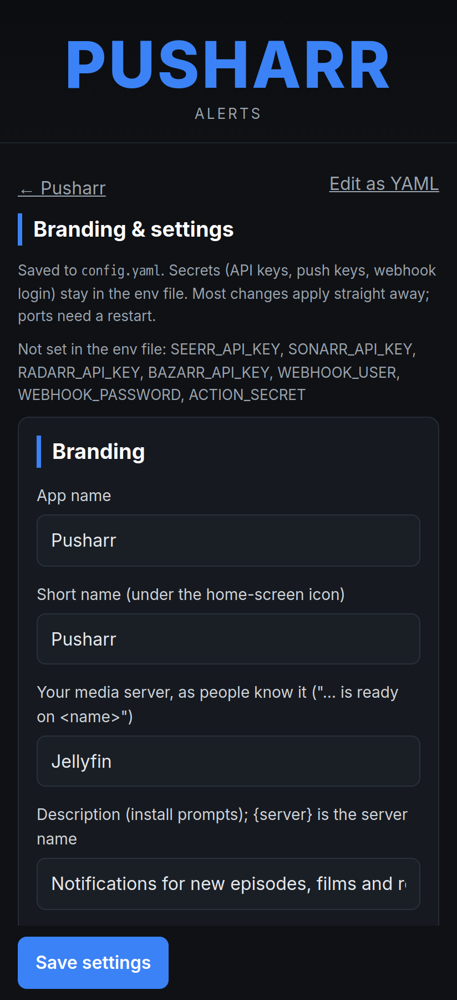

# Pusharr

Web push notifications for a Jellyfin server and its *arr stack, as a small installable web app (PWA).
People sign in with their Jellyfin account, turn notifications on for each device (phones, tablets,
computers) and choose what they hear about:

- new episodes of shows they're watching (worked out from what they actually watch)
- their requests being ready, and problems they reported being fixed
- what's new in each Jellyfin library (films, shows, anime…), straight away or in a daily digest
- announcements from the admin

Admins (or the approvers you name) approve Seerr requests and problem reports straight from the
notification. An approved problem report gets a replacement copy found and downloaded, with no gap
while it arrives. Name, colours, fonts, wordmark, icon, links and every message are set in one config
file, or on the admin's **Branding & settings** page.

| Install | Sign in | The app | A notification | Settings |
|---|---|---|---|---|
|  |  |  |  |  |

*(The neutral demo look: `python tools/demo.py`, below.)*

## Quick start

1. **Folders:** make `config/` and `data/` next to your compose file. Copy
   [`config.example.yaml`](config.example.yaml) to `config/config.yaml` and set at least `public_url`,
   `jellyfin.url` and `jellyfin.public_url`.
2. **Secrets:** copy [`.env.example`](.env.example) to `pusharr.env` and `chmod 600` it. Make a
   Jellyfin API key just for Pusharr (Dashboard → API Keys) and a long random `INTERNAL_TOKEN`. Add the
   API keys of the integrations you switch on, and a webhook login.
3. **Web push keys (once):**
   `docker run --rm -v "$PWD":/k ghcr.io/bjrb20/pusharr python tools/gen_vapid.py /k/pusharr.env`.
   Never change them afterwards: every device would have to turn notifications on again.
4. **Run it** with [`docker-compose.example.yml`](docker-compose.example.yml) (`docker compose up -d`).
   Point your HTTPS reverse proxy at port 8080 (web push needs HTTPS).
5. **Webhooks** (internal Docker network only; basic auth = `WEBHOOK_USER` / `WEBHOOK_PASSWORD`):
   - Sonarr → Settings → Connect → Webhook, *On Import*: `http://pusharr:8000/sonarr`
   - Radarr → Settings → Connect → Webhook, *On Import*: `http://pusharr:8000/radarr`
   - Seerr → Settings → Notifications → Webhook: `http://pusharr:8000/seerr`. Types: *Request
     Pending Approval*, *Request Approved*, *Request Automatically Approved*, *Media Available*, *Issue Created*.
6. **Sign in** as a Jellyfin administrator and open **Admin → Branding & settings** to make it yours.

Until the image is published, build it yourself: `docker build -t ghcr.io/bjrb20/pusharr .`

**Try it without a server:**
`docker run --rm -p 127.0.0.1:8095:8095 ghcr.io/bjrb20/pusharr python tools/demo.py`, then open
http://localhost:8095 and sign in as demo / demo. It uses a fake Jellyfin and sends nothing.

## Configuration

**Where settings live:**
- **`config.yaml`** (`/config`): everything that isn't a secret. It's merged over the defaults
  (`DEFAULTS` in [`app/config.py`](app/config.py)), so it only needs what differs.
- **The env file** (`ENV_FILE`, mounted read-only): secrets only.

**The settings page** (Admin → Branding & settings) edits `config.yaml`, as a form or as raw YAML. It
validates everything first: unknown keys, colours, https links, template variables, ports, time zone
and so on. It keeps the previous file as `config.yaml.bak` and applies changes at once; only ports
need a restart.

| Section | What you can set |
|---|---|
| `branding` | `app_name`, `short_name`, `server_name` (your media server as people know it), `description`. `theme`: about 20 colours. `fonts`: bundled Inter / Bebas Neue / system, or an uploaded `.woff2`/`.ttf`/`.otf`. `wordmark`: text with weight, spacing and glow, or an uploaded image. `icon_dir`: the icon set (see below). |
| `jellyfin` | `url` (as Pusharr reaches it), `public_url` (links and posters), `sign_in`: password and/or Quick Connect. |
| `links` | **Watch** and **Request** links; templates for one item (`watch_item`, `request_item`) and the library (`watch_home`). `recommended_apps`: per-platform store links (`ios`, `android`, `windows`, `android_tv`, `other`), optional deep links (`play.movie` / `play.show` / `play.show_tmdb` with `{tmdb}` `{tvdb}`) and where they work (`play_on`). `alternative_apps`, and a "Get the app" override. |
| `messages` | The title and text of every notification, with variables such as `{series}` `{episode}` `{count}` `{user}` `{what}` `{server}` `{app}`. The settings page lists which ones each message can use. |
| `notifications` | Per type (`episodes`, `requests`, `issues`, `announcements`, `movies`, `shows`, `anime`, `approvals`, `auto_approved`): `enabled` (offered at all) and `default` (on for new people). `digest_hour`, `timezone`, batching thresholds. Follow rules: `recent_watch_days`, `caught_up`, `watchlist`, `requested`. |
| `libraries` | "New in <library>" alerts come from your Jellyfin libraries. Per library (by name or id): `show` (default: yes, except home videos, music, collections, photos, books), `label`, `emoji`, `default` (on for new people) and `order`. People only see, and only get alerts about, libraries they can open in Jellyfin. |
| `integrations` | `seerr` (Seerr, Jellyseerr or Overseerr), `sonarr`, `radarr`, `bazarr` (subtitle problem reports, with a language), `wizarr` (optional Wizarr → Seerr user sync). Each has `enabled` and a URL; the API keys go in the env file. |
| `approvals` | `approvers`: `admins` (Jellyfin administrators) or a list of usernames. Token and expiry times. The replacement picker's rules: wanted audio languages, whether the original language is accepted, and patterns that reject dubs, hard-coded subtitles and camera copies, plus minimum sizes. |
| `server`, `session` | Ports, how long people stay signed in, and the session cookie name. |

**Secrets** (env only): `JELLYFIN_API_KEY`, `VAPID_PUBLIC_KEY`, `VAPID_PRIVATE_KEY`, `INTERNAL_TOKEN`
(required). `WEBHOOK_USER` and `WEBHOOK_PASSWORD` are needed for the webhooks. `SEERR_API_KEY`,
`SONARR_API_KEY`, `RADARR_API_KEY` and `BAZARR_API_KEY` are per integration. `ACTION_SECRET` is
recommended.

### Icons from one SVG

Upload one SVG on the settings page and Pusharr makes every size a PWA needs (`app/icons.py`, using
rsvg-convert and Pillow):
- 192 and 512 px app icons
- maskable icons, with the symbol inside the 80 % safe zone
- the Apple touch icon
- the favicon (`.ico` and 32 px)
- Android's monochrome status-bar badge

There are two modes:
- **The SVG is a symbol:** it's placed on a background colour you choose, and its silhouette becomes
  the white badge.
- **The SVG is the whole icon:** it's used as it is, and the badge is your app's initial in the
  wordmark font.

Each upload goes into its own `branding/icons-<hash>/` folder, so installed apps notice the change
and fetch the new icons. You can also put a hand-made set in a folder with the same file names and
point `branding.icon_dir` at it.

## How it works

- **Sign-in:** the password is checked with Jellyfin (`/Users/AuthenticateByName`). The Jellyfin session
  that creates is logged out straight away; only the user id and name are kept.
  - **Our own session:** a random token, stored hashed, in a `__Host-` cookie (`Secure`, `HttpOnly`,
    `SameSite=Lax`, expiring). Every hour each session re-checks that the Jellyfin account still exists
    and isn't disabled.
  - **Quick Connect:** shows a code to approve in a Jellyfin app where the person is already signed in.
    The Quick Connect secret never leaves the server. Codes expire after 5 minutes and work once.
- **Security:**
  - Every state-changing request needs the session's CSRF token and a matching `Origin`.
  - Sign-in and Quick Connect are rate-limited.
  - A strict Content-Security-Policy applies, with no inline scripts or styles.
  - Passwords and tokens are never logged or stored.
- **Web push:** standard Web Push with VAPID (RFC 8292) and aes128gcm encryption, via `pywebpush`.
  - It works in Chrome, Edge and Firefox on Android and desktop, and on iPhone/iPad (iOS 16.4+) once
    the app has been added to the home screen.
  - Subscriptions that are gone (404/410) are deleted, and ones that keep failing for 30 days are
    dropped.
- **Installing:** outside the installed app, people first get install help matched to their device
  ([`static/detect.js`](static/detect.js)):
  - **iPhone/iPad Safari:** Share → Add to Home Screen.
  - **In-app browsers:** "open this in Safari/Chrome".
  - **Chromium:** an install button.
  - **Firefox Android** and **Mac Safari:** their menu steps.

  iOS turns notifications on only from the home-screen app. A browser tab on a device where the app is
  installed says "open the installed app instead".
- **Tapping a notification opens the app**, at an in-scope page `/n/<id>`. Only the owner, or an admin,
  can open it. It shows the poster, what happened and buttons:
  - **Watch on <server>:** the exact film or episode in Jellyfin web.
  - **▶ Play in <app>:** the recommended app's deep link, on the platforms where it works, with a
    "Nothing happens? Get <app>" store link under it.
    - **Exact item:** with a `play.item` template (Plezy: `plezy://play?server={server_id}&id={item_id}`,
      where the server id is Jellyfin's own `Id`), it opens the exact episode or film. For a batch,
      that's the first new episode.
    - **Fallback:** while the item isn't known, the TMDB/TVDB link is used.
  - **Open in Seerr:** that title's request page.

  If the item wasn't in Jellyfin yet when the push went out (an import not scanned yet), the page looks
  it up by its TMDB/TVDB id when it opens, retries for a while, and remembers it once found. A tap
  reaches the note even when the installed app is already open: the service worker asks the open
  windows which one is the installed app, and the app also asks for the tapped note when it comes to
  the front.
- **Approvals:** new Seerr requests and problem reports go to the approvers.
  - **Approve / Decline** (or **Approve / Ignore**) buttons on the notification, and a **Pending**
    page.
  - Button tokens are HMAC-signed, single-use, short-lived and bound to the one device they were sent
    to.
  - Afterwards the notification is replaced with the result.
- **New episodes:** on Sonarr's import webhook, imports of the same series are batched. Then, for every
  Seerr user with a linked Jellyfin account, Pusharr checks whether they follow the show:
  - **following:** watched it in the last `recent_watch_days`
  - **caught up:** had watched the latest episode
  - **watchlist:** it's on their Seerr watchlist
  - **requested:** they requested it

  People who've already watched the new episode are skipped. Mutes, toggles and library access apply:
  nobody hears about content in a library they can't open in Jellyfin (re-read every 10 minutes and at
  sign-in). Episode alerts
  need Seerr, since that's where the list of people comes from.
- **Held until ready:** new-episode, new-film/show and request-ready alerts wait until Jellyfin has
  the item with its title, overview and poster (`notifications.wait_for_ready`).
  - Pusharr looks every 2 minutes at first, then less often.
  - After 10 minutes it asks Jellyfin to scan the new files or refresh the item.
  - After 6 hours it sends anyway.
  - `notifier.py waiting` lists what's held.
- **Approved, but not out yet:** when a film request is approved and Radarr says the film isn't out to
  download (still in cinemas, say), the requester is told the digital (else disc) release date. They
  get a short update if the date moves. Seerr's webhook needs *Request Approved* ticked.
- **Someone new joins (admins):** a new Jellyfin account (checked every minute) alerts admins.
  - **The alert:** who joined and which Wizarr invite they used, from Wizarr's database.
  - **Faster option:** point Wizarr's ntfy notification agent at `http://pusharr:8000/wizarr`, with
    the webhook login, to make the check run at once.
  - **Who gets it:** `notifications.types.joins.who` (admins by default).
- **New in <library>:** Radarr imports and a series' first file, filed under the Jellyfin library
  whose folder holds them (else wherever Jellyfin put the item). More than
  `library_burst_limit` of a kind within `library_burst_window` (a big library import, say) are sent as
  one summary. Digest subscribers get one message a day at `digest_hour`.
- **Problem reports (Seerr "Report an Issue"):**
  - **Video / audio:** asks the approvers. On **Approve**:
    1. The release that produced the current file is blocklisted (the file itself is kept).
    2. Radarr/Sonarr's interactive search runs, and only acceptable releases count: the quality
       profile and custom formats, wanted audio languages, and no dubs, camera copies, hard-coded
       subtitles or samples.
    3. The best one is grabbed, in Radarr/Sonarr's own preference order. The real torrent name is
       checked again in the queue.
    4. Radarr/Sonarr import it over the old file (with a Manual Import if the import is blocked as
       "not an upgrade").

    If nothing is acceptable, the approvers hear "No better copy available yet", and Pusharr looks
    again every 6 hours for 14 days.
  - **Subtitles:** handed to Bazarr.
  - **Other:** just tells the approvers.

  Pusharr never touches files itself. Every step is in the log and in the DB:
  `docker exec pusharr python app/notifier.py issues`.

```sh
docker exec pusharr python app/notifier.py dry-run --tvdb <id> --episodes S01E02   # who would be told, sends nothing
docker exec pusharr python app/notifier.py send-test <name>                       # one real test push
docker exec pusharr python app/notifier.py approve <seerr issue id>               # same as tapping Approve
docker exec pusharr python app/notifier.py waiting                                 # alerts held until Jellyfin has the item
```

An issue whose comment contains `[dry-run]` goes through the whole flow, but only logs what it would
do.

## Ports

| Port | What | Expose? |
|---|---|---|
| 8080 | the app and its API | yes, behind an HTTPS reverse proxy |
| 8001 | `POST /notify` etc. for trusted services (Bearer `INTERNAL_TOKEN`) | **no**, internal Docker network only |
| 8000 | Sonarr / Radarr / Seerr webhooks (basic auth) | **no**, internal only |

## Sending your own notifications

```http
POST :8001/notify
Authorization: Bearer <INTERNAL_TOKEN>

{"category": "episodes", "users": ["<jellyfin user id>"], "title": "📺 Show S1E2 is ready",
 "body": "You're up to S1E1.", "item_id": "<jellyfin item id>", "mute_key": "tvdb:12345"}
```

**Fields:**
- `category` is one of `episodes`, `requests`, `issues`, `announcements` (with `users` left out, it
  goes to everyone signed in), or `library` with a `kind` (`movies` / `shows` / `anime`) and a
  `title`.
- `item_id` adds the poster and the Watch link.

Each person's toggles and mutes apply, and the reply says what happened for each person.

## Development and tests

```sh
docker build -t ghcr.io/bjrb20/pusharr .
docker run --rm ghcr.io/bjrb20/pusharr python tests/test_config.py     # config loading, validation, templating, branding
docker run --rm ghcr.io/bjrb20/pusharr python tests/test_app.py        # end to end: fake Jellyfin, Seerr and push service
docker run --rm ghcr.io/bjrb20/pusharr python tests/test_notifier.py   # webhooks, episode decisions, picker rules
docker run --rm -v "$PWD":/w -w /w node:22-alpine node tests/test_detect.js   # device detection, real user agents
docker run --rm -v "$PWD":/w -w /w node:22-alpine node tests/test_sw.js       # notification taps in the service worker
```

**What the end-to-end test does:** the fake push service checks the VAPID signature and decrypts
every message as a browser would. It covers sign-in, Quick Connect, CSRF/Origin, prefs, mutes,
delivery, approvals, the settings page, uploads and branding.

**Code layout:**
- [`app/`](app/): Python standard library plus `pywebpush`, `PyYAML` and `Pillow`, with SQLite in
  `/data`
- [`static/`](static/): plain JS, no build step
- The bundled default icon is drawn in [`tools/pusharr-mark.svg`](tools/pusharr-mark.svg) and rendered
  by `tools/make_default_icons.py`.
- The fonts in `static/fonts` are under the SIL Open Font License; their licences sit next to them.

## Licence

MIT, see [LICENSE](LICENSE).
